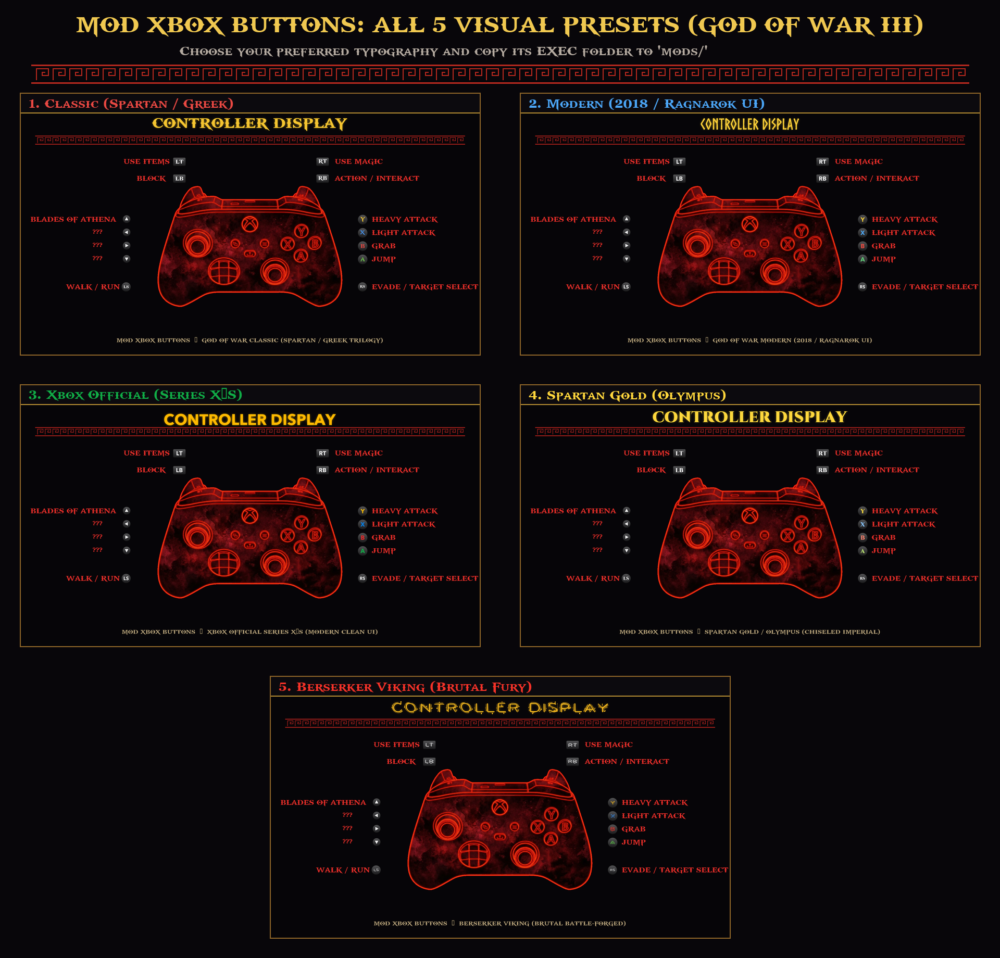

# Xbox Controller Button Mod for God of War III Remastered PC

<div align="center">

[-0078D6?logo=windows&logoColor=white)](#compatibility)
[](https://github.com/FelipePrado0/gow3_pc)
[](#features)
[](#how-to-install)
[](LICENSE)

**English** | [Português (Brasil)](README.pt-BR.md)

</div>

A high-definition controller button replacement mod for the **God of War III Remastered** PC Port (Windows / Linux). Replaces native PlayStation button prompts with authentic **Xbox Wireless Controller** prompts across menus, tutorials, QTEs, interaction points, and floating enemy execution cues.

> [!IMPORTANT]
> **No copyrighted game files are redistributed.** This mod contains only modified interface texture archives (`WAD`) that overlay non-destructively onto your own dumped copy of the game.
> This project is not affiliated with Sony Interactive Entertainment, Santa Monica Studio, or Microsoft. God of War is a registered trademark of Sony Interactive Entertainment.

---

## Contents

- [Visual Showcase](#visual-showcase)
- [Features](#features)
- [Available Presets](#available-presets)
- [How to Install](#how-to-install)
- [How to Switch Presets](#how-to-switch-presets)
- [Compatibility](#compatibility)
- [How It Works](#how-it-works)
- [Credits](#credits)
- [License](#license)

---

## Visual Showcase



---

## Features

- **Full Xbox Button Mapping**: Replaces all PlayStation face buttons ($\times, \bigcirc, \square, \triangle$) with Xbox buttons (**A, B, X, Y**), and shoulder buttons ($L1, R1, L2, R2$) with bumpers and triggers (**LB, RB, LT, RT**).
- **Preserved Native Fire Frames**: Keeps God of War's iconic animated flame borders around interactive button cues.
- **Customized Controller Menu Display**: The in-game `Controls -> Controller Display` menu renders a modern Xbox Wireless Controller with triggers, bumpers, and color-matched button discs.
- **Floating 3D Enemy Prompt Fix**: Corrects the inverted horizontal UV mapping bug on the 3D execution billboard (`MDL_5cef139e` in `R_PERM.WAD`), ensuring the **B** prompt over stunned enemies is never mirrored or backward.
- **Balanced Sub-Pixel Centering**: Action prompts (such as **RB** to grapple or open doors) are rendered with generous spacing and sub-pixel alignment, avoiding tiny or clipped text.
- **100% Non-Destructive**: Leaves original game dump files in `Image0` completely untouched.

---

## Available Presets

This repository includes **5 distinct typography styles**:

| Preset Folder | Aesthetic & Inspiration | Button Typography | Description |
| :--- | :--- | :--- | :--- |
| **`1_God_of_War_Classic`** | Spartan / Greek Trilogy | `gowfont.ttf` | Authentic heavy Greek Spartan lettering. Bold and heroic, perfectly matching the original trilogy's fire borders. |
| **`2_God_of_War_Modern`** | GoW 2018 & Ragnarök UI | `XboxClean-Bold.ttf` | Modern, clean UI typography as seen in recent Santa Monica Studio PC releases for instant QTE readability. |
| **`3_Xbox_Official_Series`** | Xbox Series X\|S Modern | `XboxClean-Bold.ttf` | Official Microsoft console interface aesthetic with vibrant standard colors and smooth discs. |
| **`4_Spartan_Gold`** | Mount Olympus / Divine | `Cinzel-Black.ttf` | Elegant imperial Roman-Greek chiseled lettering with celestial gold styling. |
| **`5_Berserker_Viking`** | Norse Berserker Rage | `berserkere.ttf` | Aggressive, blade-carved runic lettering forged with glowing battle embers. |

---

## How to Install

No scripts, batch files, or third-party mod managers are required. Installing is as simple as placing the mod into your `mods` folder:

1. Download or clone this repository.
2. Choose your preferred preset folder (for example: `1_God_of_War_Classic`).
3. Copy its `EXEC` folder:
   ```text
   Xbox Controller Mod For God of War III PC Port/
   └── 1_God_of_War_Classic/
       └── EXEC/
   ```
4. Paste it into your game's `mods/Xbox_Buttons/` folder:
   ```text
   God of War III Remastered (Game Root)/
   ├── God of War III.exe
   ├── Play God of War III.exe
   └── mods/
       └── Xbox_Buttons/
           └── EXEC/
               └── WAD/
                   └── PS4_LE/
                       ├── R_PERM.WAD
                       └── R_UI.WAD
   ```
5. Launch the game normally via **`Play God of War III.exe`** or **Playnite**!

---

## How to Switch Presets

To switch to a different style at any time:
1. Open the folder of the new preset you want (e.g. `2_God_of_War_Modern`).
2. Copy its `EXEC` folder.
3. Paste and overwrite inside your game's `mods/Xbox_Buttons/` directory.

---

## Compatibility

- **Operating System**: Windows 10/11 (64-bit) & Linux (AppImage).
- **Game Versions**: Tested on `CUSA01623` and `CUSA01715` (Versions 01.00 and 01.02).
- **Runtime**: Fully compatible with native resolution patches (720p, 1080p, 1440p, 4K), 60/120 FPS patches, and Ultrawide mods.

---

## How It Works

The God of War III PC port loader features a built-in virtual file system layer. When starting the game, any file structure present inside `mods/<Mod_Name>/EXEC/` is automatically mounted over `/app0/EXEC/` in memory.

Because this mod only modifies texture entries inside `R_UI.WAD` (2D UI, menus, QTEs) and `R_PERM.WAD` (3D floating QTE billboards), it completely bypasses modifying your original PS4 dump. To uninstall, simply delete the `mods/Xbox_Buttons` folder.

---

## Credits

- **Felipe Prado & kvicken**: Creators of the God of War III Remastered PC port.
- **Santa Monica Studio & Sony Interactive Entertainment**: Original game and assets.
- **Microsoft**: Xbox controller design and trademark.

---

## License

This project is licensed under the **GNU General Public License v2.0 (GPL-2.0)** - matching the licensing of the God of War III PC port tools.
